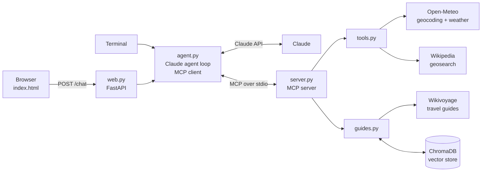

# Travel Planner Agent

An AI travel planning assistant built with Claude. Ask it to plan a day anywhere, and it checks the live weather forecast, finds nearby landmarks and searches real travel guides, then answers with citations.

> **"Plan a rainy day in Melbourne tomorrow"**
> → checks the forecast (thunderstorms), searches the Wikivoyage guide for indoor activities, finds nearby landmarks, and builds an itinerary around covered arcades, museums and theatres, citing each source.

This project demonstrates three core skills:

- **Agent with tool use:** Claude decides which tools to call, in what order, and loops until it can answer.
- **MCP (Model Context Protocol):** the tools live in an MCP server, and the agent connects to it as an MCP client. Any MCP app (for example Claude Desktop) can use the same server.
- **RAG (Retrieval-Augmented Generation):** Wikivoyage travel guides are chunked, embedded and stored in a vector database, so answers are grounded in real sources and cited.

---

## Contents

1. [Architecture](#architecture)
2. [Files at a glance](#files-at-a-glance)
3. [How each file works](#how-each-file-works)
4. [Walkthrough: one question from start to finish](#walkthrough-one-question-from-start-to-finish)
5. [Setup and run](#setup-and-run)
6. [Design decisions](#design-decisions)
7. [Challenges and what I changed](#challenges-and-what-i-changed)
8. [Limitations and next steps](#limitations-and-next-steps)
9. [Credits](#credits)

---

## Architecture



The project is built in **layers**. Each layer only talks to the one next to it:

| Layer          | Files                                        | Job                                                         |
| -------------- | -------------------------------------------- | ----------------------------------------------------------- |
| Interface      | `index.html`, `web.py` (or the terminal) | Take the user's message, show the answer and the tool calls |
| Agent          | `agent.py`                                 | Talk to Claude, run the agent loop, keep the conversation   |
| Protocol       | `server.py`                                | Expose the tools over MCP                                   |
| Tools and data | `tools.py`, `guides.py`                  | Fetch live data and search the travel guides                |

Because of this split, `agent.py` contains **no** weather or guide code. It just asks the MCP server what tools exist and asks it to run them.

---

## Files at a glance

```
travel-planner-agent/
├── agent.py            # Claude agent loop + MCP client (also a terminal chat)
├── server.py           # MCP server: exposes the tools
├── tools.py            # Live-data tools: geocoding, weather, landmarks
├── guides.py           # RAG: download, chunk, embed and search Wikivoyage guides
├── web.py              # FastAPI web backend (POST /chat, serves the page)
├── index.html          # Web chat interface (shows the tool calls)
├── try_client.py       # Experiment: a minimal MCP client
├── try_embeddings.py   # Experiment: what embeddings and similarity look like
├── requirements.txt    # Exact package versions
├── .env                # Your API key (NOT committed)
├── .gitignore          # Files Git must ignore (.env, .venv, .chroma, ...)
└── .chroma/            # The vector database, created automatically (NOT committed)
```

---

## How each file works

### `tools.py`: live-data tools

Plain Python functions that fetch real data from free public APIs (no API key needed). They know nothing about Claude or MCP, so each can be tested on its own with `python tools.py`.

| Function                                                    | What it does                                                                                                                                                                                                                  |
| ----------------------------------------------------------- | ----------------------------------------------------------------------------------------------------------------------------------------------------------------------------------------------------------------------------- |
| `find_place(name)`                                        | Calls the Open-Meteo geocoding API and returns the best match's name, state, country, latitude, longitude and timezone, or `None` if nothing matches.                                                                       |
| `get_forecast(latitude, longitude, start_date, end_date)` | Calls the Open-Meteo forecast API (up to 16 days ahead). The API returns one list per measurement, so the function regroups it into **one dict per day** and turns WMO weather codes into words with `WEATHER_CODES`. |
| `find_landmarks(latitude, longitude, radius_km, limit)`   | Uses Wikipedia's `geosearch` to find articles near a point, each with a short description. Articles without a description are skipped.                                                                                      |
| `find_attractions(...)`                                   | An earlier version using the OpenStreetMap Overpass API. Kept for reference but **not exposed** to the agent, because the free servers often timed out (see *Challenges*).                                            |

Each function uses `httpx` to call the API, `raise_for_status()` to stop on HTTP errors, and `.get()` to avoid crashing when a field is missing.

### `guides.py`: the RAG pipeline

Turns Wikivoyage travel guides into a searchable knowledge base.

| Function                             | What it does                                                                                                                                                                                                               |
| ------------------------------------ | -------------------------------------------------------------------------------------------------------------------------------------------------------------------------------------------------------------------------- |
| `fetch_guide(city)`                | Downloads the city's Wikivoyage article as plain text via the MediaWiki API.                                                                                                                                               |
| `split_sections(text)`             | Walks the text line by line. A regular expression (`HEADING`) recognises headings like `== Eat ==`; the number of `=` signs separates main sections from sub-sections, giving labels like `Eat > Vietnamese`.      |
| `make_chunks(city)`                | Splits long sections at paragraph breaks so no chunk is much over 1,200 characters. Each chunk keeps its `city` and `section` label.                                                                                   |
| `index_city(city)`                 | Stores the chunks in ChromaDB with `upsert`. Chroma **embeds** each chunk with a local model (all-MiniLM-L6-v2). Ids like `Melbourne-12` prevent duplicates.                                                     |
| `search_guides(query, city, k)`    | Embeds the query and returns the `k` most similar chunks (cosine similarity), filtered to one city with `where={"city": city}`.                                                                                        |
| `search_travel_guide(query, city)` | The function the agent uses. **Indexes the city first if it isn't stored yet**, then returns the top 5 passages as text, each starting with a source label such as `[Wikivoyage: Melbourne > Get around > Trams]`. |

**Why RAG?** A city guide is around 75,000 characters. Sending it all with every question would be slow, costly and noisy. Instead, only the 5 most relevant passages are given to Claude, and each one carries a label Claude can cite.

**Why embeddings?** They let the search match **meaning**, not just words. "Where can I get cheap food?" matches a passage about "budget eateries and inexpensive dumplings" even though they share no words.

The database path is built from `__file__` (`Path(__file__).parent / ".chroma"`), so it works no matter which folder the program starts from.

### `server.py`: the MCP server

Exposes the tools through the Model Context Protocol. Each tool is a small wrapper marked with `@mcp.tool()`:

```python
@mcp.tool()
def find_place(name: str) -> dict | None:
    """Look up a city or place by name. Returns its country, latitude and longitude.
    Call this before tools that need coordinates."""
    return tools.find_place(name)
```

- The MCP library builds each tool's description from the **function name, docstring and type hints**, so no JSON schema is written by hand.
- The wrappers only call the real functions in `tools.py` and `guides.py`; no logic is duplicated.
- `mcp.run()` starts the server and talks to clients over **stdin/stdout**. That's why the server must never `print()`, since that would corrupt the messages.

Exposed tools: `find_place`, `get_forecast`, `find_landmarks`, `search_travel_guide`.

### `agent.py`: the agent (Claude loop + MCP client)

The "brain" connection. It knows nothing about weather or guides.

**Settings**

- `client = anthropic.AsyncAnthropic()` is the Claude API client (async, to work with MCP).
- `MODEL`, `MAX_ROUNDS` (a safety limit of 5) and `SYSTEM`, the system prompt. It gives Claude today's date (so "tomorrow" works), tells it to use tools instead of guessing, to cite guide passages, and to warn that guide details may be out of date.
- `SERVER` says how to start `server.py` (with an absolute path).

**Functions**

| Function                                    | What it does                                                                                                                                                                       |
| ------------------------------------------- | ---------------------------------------------------------------------------------------------------------------------------------------------------------------------------------- |
| `load_tools(session)`                     | Asks the MCP server for its tools (`list_tools`) and converts them to the format the Claude API expects: `name`, `description`, `input_schema`.                            |
| `run_tool(session, name, inputs)`         | Asks the MCP server to run a tool (`call_tool`) and returns the result as text. Errors are returned as text too, so Claude can retry or explain instead of the program crashing. |
| `ask(session, tools, messages, question)` | **The agent loop** (see below). Returns the answer **and** a list of the tool calls made (`steps`).                                                                  |
| `main()`                                  | Starts the server, connects (`initialize` is the MCP handshake), loads the tools, then runs a chat in the terminal.                                                              |

**The agent loop (`ask`)**

1. Add the user's question to `messages`, the conversation history.
2. Send `messages`, the system prompt and the tool list to Claude.
3. Save Claude's reply in `messages`.
4. If `stop_reason` is **not** `"tool_use"`, Claude has finished: return its text. (If it's `"max_tokens"`, a note says the answer was cut off.)
5. Otherwise, for each `tool_use` block in the reply, run the tool through MCP and build a `tool_result`, linked to the request by `tool_use_id`.
6. Add the results to `messages` as a user turn and go back to step 2, at most `MAX_ROUNDS` times.

**Memory:** Claude doesn't remember anything between API calls, so the full `messages` list is sent each time. Keeping that list between questions is what makes follow-ups like "what about food near there?" work.

### `web.py`: the web backend (FastAPI)

| Part            | What it does                                                                                                                                                                            |
| --------------- | --------------------------------------------------------------------------------------------------------------------------------------------------------------------------------------- |
| `lifespan`    | Runs once at startup: starts `server.py`, connects with MCP and loads the tools. The connection stays open for all requests, so the vector database isn't reloaded for every message. |
| `ChatRequest` | A Pydantic model describing what the browser must send: `conversation_id` and `message`. FastAPI validates it automatically.                                                        |
| `POST /chat`  | Finds (or creates) that conversation's `messages` list, runs `ask()`, and returns `{"answer": ..., "steps": [...]}` as JSON. Each browser tab has its own conversation.           |
| `GET /`       | Serves `index.html`.                                                                                                                                                                  |

FastAPI also generates an interactive API test page at `/docs`.

### `index.html`: the chat page

Plain HTML, CSS and JavaScript, with no framework.

- **HTML:** a title, the chat area and an input box.
- **CSS:** blue bubbles for the user, white for the agent, a grey box for tool calls.
- **JavaScript:** on Send, it shows the message and a "Thinking…" placeholder, sends `{conversation_id, message}` to `/chat` with `fetch`, then shows the **tool calls** followed by the answer.
- **Safety:** user text is escaped, and Claude's markdown is converted with `marked` and cleaned with `DOMPurify` before it's shown.
- `crypto.randomUUID()` gives each browser tab its own conversation id.

### `try_client.py` and `try_embeddings.py`: learning experiments

Small scripts I wrote while learning, kept to show the process:

- `try_client.py` connects to the MCP server, lists its tools (showing the auto-generated input schemas) and calls one tool directly.
- `try_embeddings.py` turns a few sentences into 384-number embeddings and compares them with cosine similarity, showing that "cheap food" matches "budget eateries" (0.49) far better than unrelated text (0.05).

### Supporting files

- **`requirements.txt`:** the exact package versions, created with `pip freeze`. Install them with `pip install -r requirements.txt`.
- **`.env`:** holds `ANTHROPIC_API_KEY`, loaded with `python-dotenv`. **Never committed.**
- **`.gitignore`:** keeps `.env`, `.venv/`, `.chroma/` and `__pycache__/` out of Git.
- **`.chroma/`:** the vector database, created automatically on first use. It can always be rebuilt, so it isn't committed.

---

## Walkthrough: one question from start to finish

**User (in the browser):** *"Plan a rainy day in Melbourne tomorrow"*

1. **`index.html`** sends `{"conversation_id": "...", "message": "Plan a rainy day..."}` to `POST /chat`.
2. **`web.py`** finds this tab's conversation and calls `ask()`.
3. **`agent.py`** adds the question to `messages` and sends it to Claude with the system prompt (including today's date) and the 4 tools from the MCP server.
4. **Claude** decides it needs data and replies with **four tool requests at once**:
   - `find_place({"name": "Melbourne"})`
   - `search_travel_guide({"city": "Melbourne", "query": "indoor things to do on a rainy day"})`
   - `get_forecast({..., "start_date": "2026-11-28", ...})`
   - `find_landmarks({..., "radius_km": 3})`
5. **`agent.py`** asks **`server.py`** to run each one over MCP:
   - `tools.py` calls Open-Meteo and Wikipedia
   - `guides.py` searches ChromaDB and returns 5 labelled guide passages
6. The results go back to Claude as `tool_result` messages.
7. **Claude** writes the plan: the forecast says thunderstorms, so it chooses indoor places from the guide (State Library, NGV, arcades), adds nearby landmarks, and cites sources like `(Wikivoyage: Melbourne > See > Sights & museums)`.
8. **`ask()`** returns the answer and the 4 tool steps; **`web.py`** sends them back as JSON.
9. **`index.html`** shows the tool calls in a grey box, then the formatted answer.

**Follow-up:** *"What about food near there?"* The same `messages` list is used, so Claude knows "there" means the CBD stops it just suggested, and searches the guide for food.

---

## Setup and run

Requires Python 3.11+ and an [Anthropic API key](https://console.anthropic.com/).

```bash
git clone https://github.com/htetnay-origin/travel-planner-agent.git
cd travel-planner-agent
python3 -m venv .venv
source .venv/bin/activate          # Windows: .venv\Scripts\activate
pip install -r requirements.txt
```

Create a `.env` file:

```
ANTHROPIC_API_KEY=your-key-here
```

**Web app:**

```bash
uvicorn web:app --port 8000
```

Then open http://localhost:8000

**Terminal chat:**

```bash
python agent.py
```

**Test the tools on their own (no Claude needed):**

```bash
python tools.py
python guides.py
```

**Use the MCP server from Claude Desktop (optional).** Add this to `claude_desktop_config.json`, using full paths:

```json
"mcpServers": {
  "travel-planner": {
    "command": "/full/path/to/travel-planner-agent/.venv/bin/python",
    "args": ["/full/path/to/travel-planner-agent/server.py"]
  }
}
```

The first run downloads the embedding model (~80 MB). The first question about a new city downloads and indexes its guide, which takes a few seconds.

---

## Design decisions

| Decision                                                 | Why                                                                                                                                   |
| -------------------------------------------------------- | ------------------------------------------------------------------------------------------------------------------------------------- |
| Tools in a separate MCP server                           | The same tools work in my agent, Claude Desktop or any MCP client, and the agent has no tool-specific code.                           |
| Tool functions separate from the server wrappers         | Functions can be tested without Claude or MCP; the server only adds descriptions.                                                     |
| Tool descriptions from docstrings and type hints         | One source of truth, with no hand-written JSON schemas.                                                                               |
| Tool descriptions that steer behaviour                   | For example, "some results are not attractions, only recommend real places": the model does the judgement instead of fragile filters. |
| Tool errors returned to Claude as text                   | The agent can retry or explain instead of crashing.                                                                                   |
| Max 5 agent rounds                                       | Prevents runaway loops and unexpected cost.                                                                                           |
| Chunk by guide section, then by paragraph (~1,200 chars) | Chunks stay on one topic and keep a label for citations.                                                                              |
| Local embedding model                                    | Free, private and fast, with no second API key.                                                                                       |
| Index cities on demand                                   | Works for any city with a Wikivoyage guide, without a setup step.                                                                     |
| Today's date in the system prompt                        | So "tomorrow" and "this weekend" become real dates.                                                                                   |
| Citations required in the system prompt                  | Makes answers verifiable and reduces hallucination.                                                                                   |
| One MCP connection for the whole web server              | Avoids restarting the server and reloading the database for every message.                                                            |

---

## Challenges and what I changed

- **Unreliable map API.** The OpenStreetMap Overpass API often failed (502 errors and timeouts). I added a backup server, made the query lighter, and finally switched landmark search to Wikipedia geosearch, which is faster and returns notable places.
- **Noisy landmark data.** Wikipedia results include streets, offices and historical incidents. Rather than a fragile keyword filter, the tool keeps short descriptions and the tool description tells Claude to recommend only real attractions.
- **Missing coordinates.** Only the first 10 Wikipedia results had coordinates; adding `colimit=max` fixed it.
- **Truncated answers.** Long answers were cut off mid-sentence (`stop_reason == "max_tokens"`). I raised the limit and now flag any truncation.
- **Relative paths.** The vector database and MCP server failed when started from another folder, so all paths are built from `__file__`.
- **Retrieval nuance.** Semantic search reliably finds the right topic ("food") but is weaker on details ("cheap" food). Returning the top 5 chunks lets Claude pick the most relevant.
- **Python version.** macOS's built-in Python 3.9 was too old for the MCP SDK, so the project uses Python 3.13 in a virtual environment.

---

## Limitations and next steps

- **Evals:** add an automated test set that checks tool selection, key facts and that every citation exists in the guide database.
- **Better retrieval:** include section labels in the embedded text, index Wikivoyage district pages (big cities keep most attractions there), and try a stronger embedding model.
- **Streaming:** show tool calls and the answer as they happen.
- **Safe deployment:** the app isn't publicly deployed, because every message uses my API credit. A public version would need authentication, rate limiting and a spending cap.
- **Freshness:** guide content can be out of date; the agent tells users to check prices and opening hours.

---

## Credits

- Travel guide content: [Wikivoyage](https://en.wikivoyage.org/), licensed CC BY-SA
- Weather and geocoding: [Open-Meteo](https://open-meteo.com/)
- Landmarks: [Wikipedia](https://en.wikipedia.org/)
- Built with the [Anthropic Claude API](https://docs.claude.com/), the [MCP Python SDK](https://modelcontextprotocol.io/), [ChromaDB](https://www.trychroma.com/) and [FastAPI](https://fastapi.tiangolo.com/)

## Author

<Your Name></your> · Htet Nay Bala
